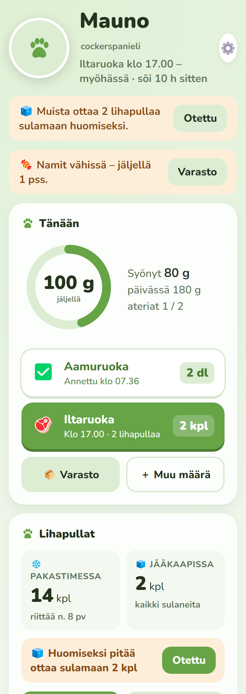
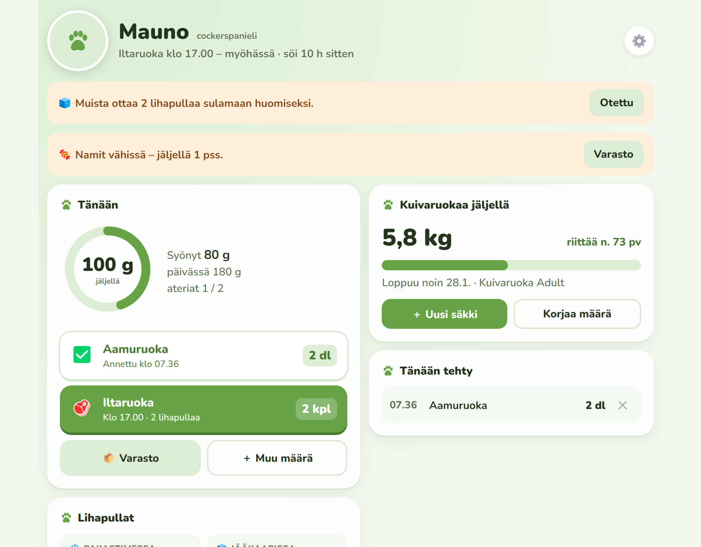

# Maunon ruokinta 🐾

Mauno-cockerspanielin ruokinnan seurantasovellus. Toimii puhelimessa asennettavana sovelluksena (PWA), myös ilman verkkoa, ja jakaa tiedot Lassin ja Annikan kesken.

**👉 https://lassisalminen.github.io/mauno-ruokinta/**

| Puhelin | Tietokone |
|---|---|
|  |  |

## Ominaisuudet

- **Käyttöönottokysely:** nimi, kuva (sivun värit poimitaan kuvasta), ikä ja paino, päiväannos grammoina tai desilitroina, ateriat (kuiva g/dl, märkä g/prk, raaka lihapullat kpl) ja varastot.
- **Ateriakirjaus yhdellä napautuksella**, tuplaruokinnan esto ja kumoa-toiminto.
- **Kuivaruoka:** säkin ennuste kulutuksen perusteella ja varoitus ennen loppumista.
- **Lihapullat:** pakastin, jääkaappi, sulatus ja muistutus ottaa huomisen pullat sulamaan.
- **Varasto:** namit, luut, märkäruoka ym. Märkäruokapurkit vähenevät automaattisesti.
- **Muistiinpanot** ja "viimeksi"-rivi (maitohappobakteeri, matolääke, kynnet…).
- **Jaettu data** Firebasen kautta, kirjautuminen Google-tilillä.
- **Push-muistutukset:** sulatus, kirjaamaton ateria ja vähissä olevat varastot.

## Käyttöönotto puhelimessa

1. Avaa linkki puhelimen selaimessa (Android: Chrome, iPhone: Safari).
2. **Kirjaudu Googlella.** Tilisi pitää olla lisätty jäseneksi; omistaja lisää jäsenet sivun alalaidan *👥 Lisää jäsen* -napista.
3. **Lisää kotinäytölle:** Android: ⋮ → *Asenna sovellus*. iPhone: Jaa → *Lisää Koti-valikkoon*.
4. Avaa sovellus kotinäytöltä ja paina **🔔 Ota muistutukset käyttöön** → Salli.
   iPhonessa ilmoitukset toimivat vain kotinäytölle lisätyssä sovelluksessa (iOS 16.4+).

Jos Firebasea ei ole määritetty tai valitset *Jatka ilman kirjautumista*, tiedot tallentuvat vain kyseiseen selaimeen (localStorage).

## Miten tämä toimii

```
index.html            käyttöliittymä ja sovelluslogiikka
src/logic.js          jaettu laskenta (rawNeed, kuivaruokaennuste, muistutukset) – selain + Node
src/firebase-adapter.js  window.claude.use('db'|'user') Firestoren ja Firebase Authin päälle
src/firebase-config.js   Firebasen web-config (ei salainen)
sw.js                 service worker: offline-välimuisti ja push-ilmoitukset
manifest.webmanifest  PWA-manifest, ikonit kansiossa icons/
firestore.rules       pääsy vain households/mauno.members-listan sähköposteille
scripts/send-reminders.mjs  muistutusten lähettäjä (GitHub Actions, 30 min välein)
```

Kaikki data on Firestoressa polun `households/mauno/…` alla: `config/settings`, `stock/base`, `raw/base`, `feeds`, `rawlog`, `purchases`, `notes`, `items`, `profiles`, `pushTokens`, `sentReminders`.

## Kehitys

Tarvitaan Node.js 22+.

```bash
npm install
```
```bash
npm start
```
Sovellus aukeaa osoitteessa http://localhost:4173/.

Muut komennot:

| Komento | Mitä tekee |
|---|---|
| `npm test` | Yksikkötestit + Playwright-e2e-testit |
| `npm run test:unit` | Logiikan ja Firebase-adapterin yksikkötestit (`node --test`) |
| `npm run test:e2e` | Playwright, headless Chromium |
| `npm run icons` | Generoi PWA-ikonit uudelleen |
| `npm run screenshots` | Päivittää README:n kuvakaappaukset |
| `npm run reminders -- --dry-run` | Muistutusten kuivaharjoitus (vaatii `FIREBASE_SERVICE_ACCOUNT`-ympäristömuuttujan) |

Ennen ensimmäistä e2e-ajoa:
```bash
npx playwright install chromium
```

### Testit

- **E2E (Playwright):** käyttöönottokysely, aterian kirjaus ja tuplaruokinnan varoitus, kumoa, sulatus ja `rawNeed()`, varaston +/− ja märkäruoan automaattinen vähennys, muistiinpanot ja "viimeksi"-rivi, 390 px mobiilinäkymä, PWA-asennettavuus ja offline-käyttö sekä Firebase-kirjautuminen feikattuja Firebase-moduuleja vasten.
- **Yksikkötestit:** jaettu laskenta ja muistutusehdot sekä Firebase-adapteri in-memory-Firestorea vasten.
- **CI:** [`.github/workflows/ci.yml`](.github/workflows/ci.yml) ajaa kaikki testit jokaisesta pushista.

### Julkaisu

GitHub Pages julkaisee `main`-haaran juuren automaattisesti jokaisen pushin jälkeen. Kun muutat service workerin välimuistissa olevia tiedostoja merkittävästi, nosta `VERSION`-arvoa tiedostossa `sw.js`.

### Muistutukset

[`.github/workflows/reminders.yml`](.github/workflows/reminders.yml) ajaa skriptin `scripts/send-reminders.mjs` 30 minuutin välein Helsingin ajassa:

- **klo 17–21:** "🧊 Ota N lihapullaa sulamaan huomiseksi" (sama laskenta kuin sovelluksen `rawNeed()`)
- **ateria yli 60 min myöhässä:** "🍽️ Iltaruoka on kirjaamatta"
- **kerran päivässä klo 10 jälkeen:** kuivaruoka, pakastin tai varastotuote alle varoitusrajan

Lähetetyt muistutukset kirjataan `sentReminders`-kokoelmaan, joten samaa viestiä ei lähetetä kahdesti. Jos `FIREBASE_SERVICE_ACCOUNT`-salaisuus puuttuu, ajo ohitetaan siististi.

Käyttöönoton puuttuvat askeleet ovat tiedostossa [BLOCKERS.md](BLOCKERS.md), tehdyt ratkaisut tiedostossa [DECISIONS.md](DECISIONS.md).
